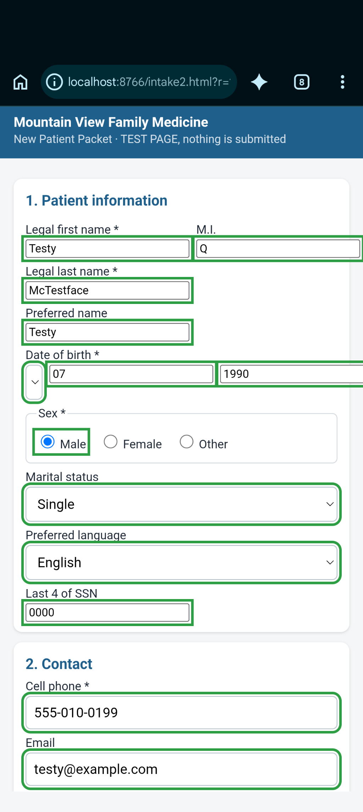
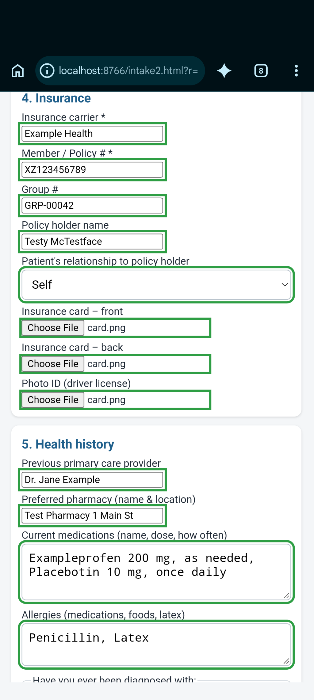
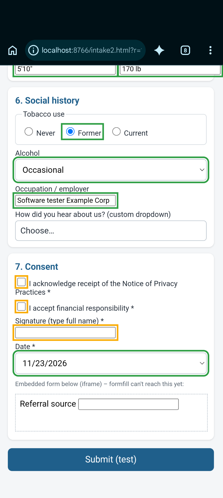
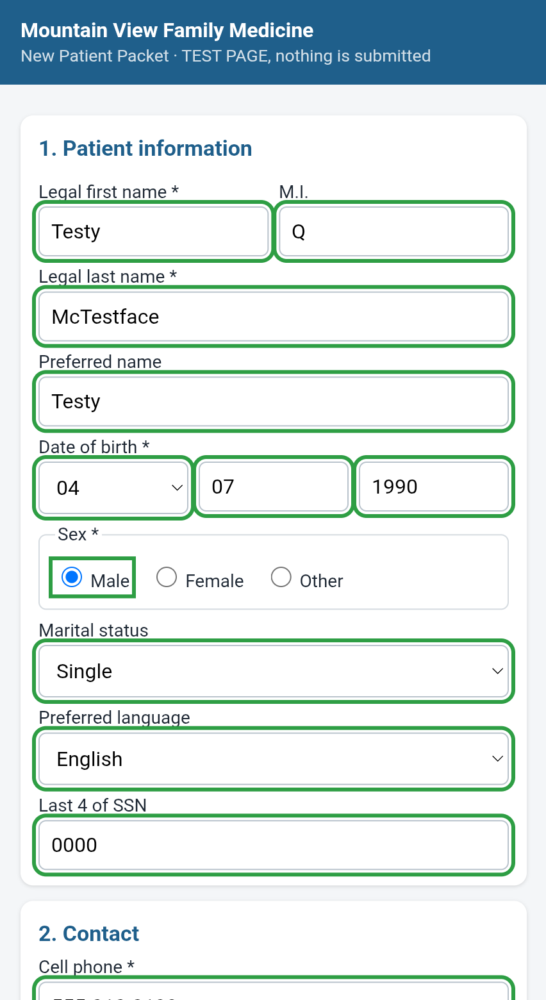
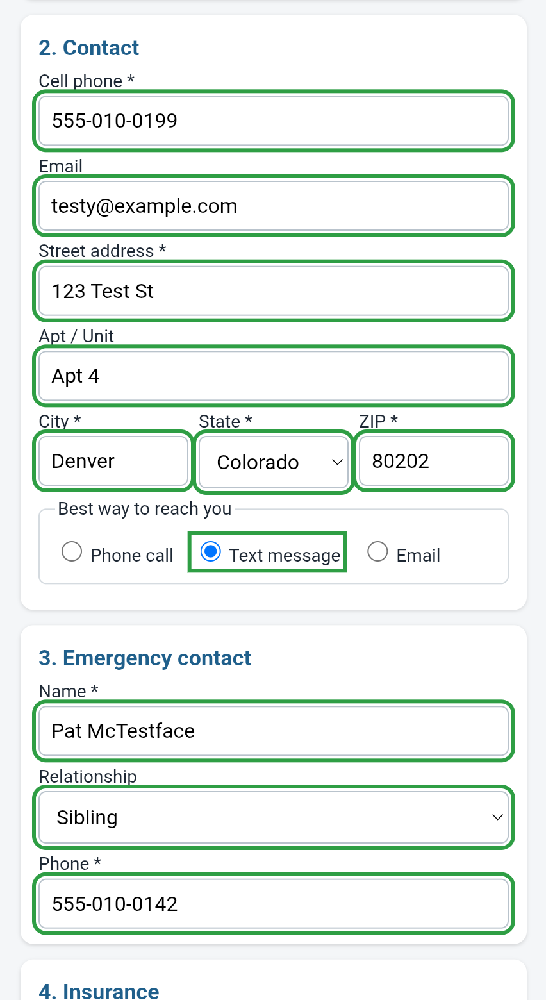
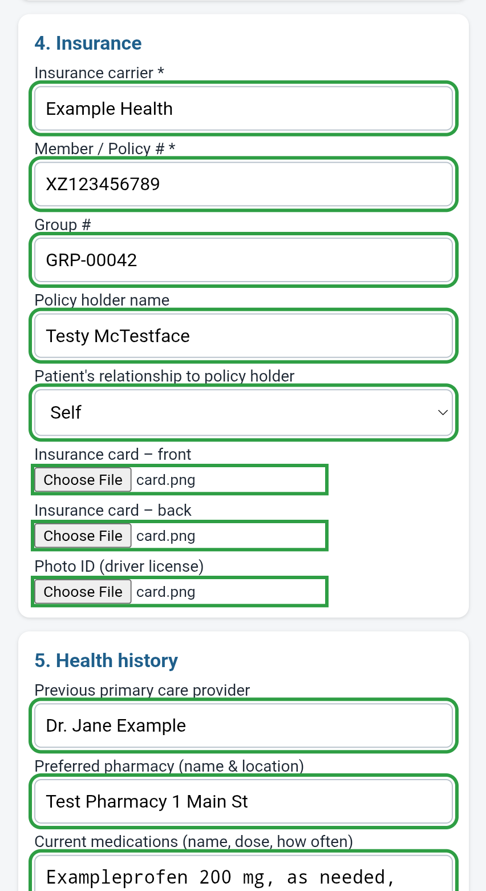
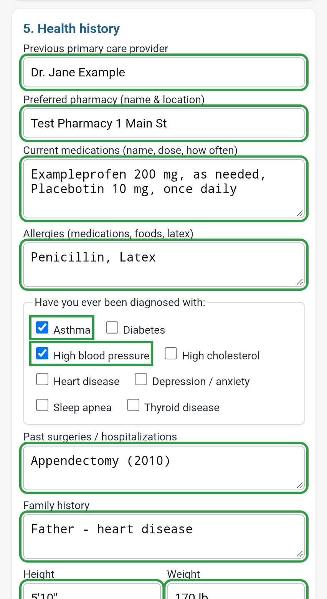
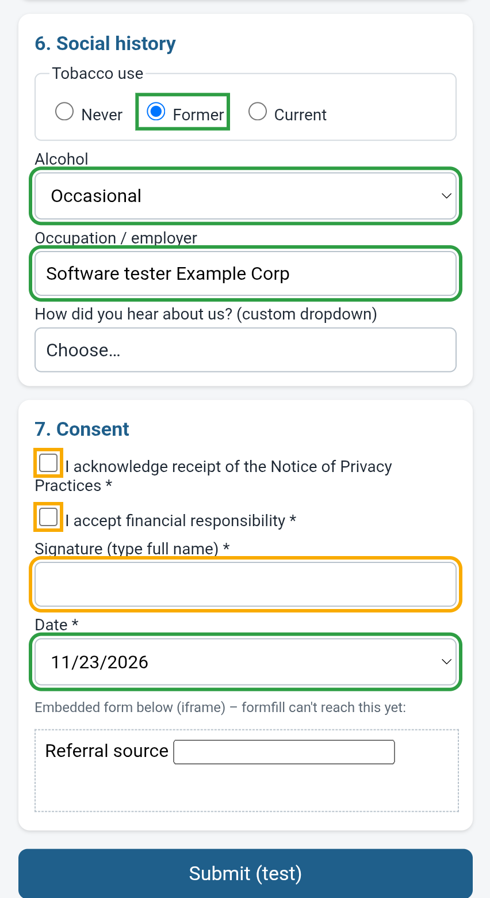

# formfill

**Fill a 46-field doctor's intake form on your phone in 1.5 seconds, without your AI agent ever seeing your data.**

<p align="center">
  
  
  
</p>
<p align="center"><sub>Real Chrome on a Pixel, filled from a fake demo profile.
<b>Green</b> = filled · <b>Orange</b> = required, left for you (consent and signature are never filled).</sub></p>

Fills web forms (doctor intake, check-in) in Chrome **on your Android phone**
from an encrypted profile, in about a second.

It's built for use with an AI agent such as Claude Code. The agent sees field
labels and profile *key names*, writes the mapping, and runs the fill. It never
sees your values: name, DOB, insurance IDs and medical history stay encrypted
on disk and only exist decrypted in RAM while unlocked.

## Every section
The same 46-field new-patient packet (`test/intake2.html`) filled in 1.5 s from the
fake demo profile. Green = filled. Orange = required but left for you: the
consent boxes and signature are never filled.

<p>





</p>

```
$ formfill fill
Filled in 1.5s on localhost:8766: 43 filled
  required & still empty: hipaa, fin, sig
Green = filled, red = couldn't fill, orange = required but empty. Review, sign, and submit yourself.
```

## How it works

```
 Pixel phone (Android 15+)
 ├── Chrome ◄── DevTools socket (localabstract:chrome_devtools_remote)
 │                 ▲
 │                 │ adb forward tcp:9222
 │                 │
 │   adbd :5555 ◄──┘ (adb over TCP, reached via the VM's virtual gateway)
 │
 └── Linux Terminal app ── Debian VM
        └── formfill.py  (+ Claude Code, adb, age)
```

Everything runs **on the phone itself**. Android's built-in *Linux Terminal*
app (Android Virtualization Framework) runs a Debian VM. From inside the VM,
the phone is reachable as the VM's default gateway
(`ip route | awk '/default/{print $3}'`), so the VM can `adb` into its own
host phone. formfill then forwards Chrome's DevTools socket and drives the open
tab directly: one script reads every field and fills them all at once, instead
of an agent tapping through the screen.

No computer or USB cable is needed. Day to day, Wi-Fi isn't needed either; after a
reboot you need it once, briefly (see [Wi-Fi](#wi-fi)).

## Setup

### 1. Enable the Linux Terminal (Debian VM)
1. Settings → About phone → tap **Build number** 7× to unlock Developer options.
2. Settings → System → Developer options → **Linux development environment** → on.
3. Open the **Terminal** app and let it download and install Debian.

### 2. Install packages in the VM
```bash
sudo apt-get update
sudo apt-get install -y adb age nmap python3-yaml python3-websocket git
```

### 3. Get the code
```bash
git clone https://github.com/matthenry87/formfill.git ~/formfill
mkdir -p ~/.local/bin
ln -s ~/formfill/formfill.py        ~/.local/bin/formfill
ln -s ~/formfill/scripts/adb-ensure ~/.local/bin/adb-ensure
```
(Make sure `~/.local/bin` is on your `PATH`.)

### 4. Let the VM adb into the phone (one time)
1. Developer options → **Wireless debugging** → on.
2. Tap **Pair device with pairing code**. Keep the dialog open, then in the VM:
   ```bash
   GW=$(ip route | awk '/default/{print $3; exit}')
   adb pair $GW:<pairing-port> <6-digit-code>
   ```
   The code expires when the dialog closes; if it fails, reopen it and use the new code.
3. Run `adb-ensure`. It finds the Wireless debugging port, switches adbd to
   TCP port **5555** (`adb tcpip 5555`), and connects. If the phone asks
   *Allow USB debugging?* for the VM's key, tap **Always allow**.

### 5. Reconnect automatically (survives reboots)
Android drops port 5555 on every reboot, and the Wireless debugging port is
random. `scripts/adb-ensure` handles both. It:
1. tries `<gateway>:5555`;
2. otherwise scans the gateway's ports 30000–50000, connects to whichever one
   adb accepts (other services listen there too), re-runs `adb tcpip 5555`, and
   reconnects.

The gateway IP can change across reboots, so the script looks it up each time.
To run it in the background whenever a terminal opens, add to `~/.bashrc`:
```bash
alias adbc='adb-ensure'
if [[ $- == *i* ]] && command -v adb-ensure >/dev/null; then
  (adb-ensure -q >/dev/null 2>&1 &)
fi
```
Right after a reboot, `adb devices` may briefly show `offline` while adbd
restarts; wait 15–20 s or run `adbc`.

### 6. Create your profile
```bash
formfill init        # opens profile.template.yaml in nano; save, then pick a passphrase
formfill edit        # change it later
```
The profile is stored as `profile.yaml.age` (encrypted with [age](https://age-encryption.org)).
Put insurance card / ID photos in `~/formfill/files/` and list their paths under
`files:` in the profile. `.gitignore` excludes both, so keep it that way.

## At the doctor's office
1. Open the form link in Chrome. It needs to be the **visible** tab, because
   Chrome's DevTools doesn't respond while Chrome is in the background.
2. `formfill unlock` (passphrase; the decrypted copy lives in `/dev/shm` for
   30 min, then auto-wipes).
3. Ask the agent to "fill it". Or, for a site that's already mapped, run `formfill fill` yourself.
4. Check the page: green = filled, red = couldn't fill, orange = required but still empty.
   **Sign and submit yourself.**
5. `formfill lock` wipes the decrypted profile and removes uploaded photos from the phone.

### Instructions for the AI agent
- `formfill scan` → list fields; `formfill keys` → profile key names.
- Write or extend `maps/<host>.yaml`, then `formfill fill` and report the summary.
- Never read `/dev/shm/formfill/profile.yaml` or print profile values.
- Never submit or sign. Leave consent/attestation boxes as `skip` unless told otherwise.

## Commands
| | |
|---|---|
| `formfill scan` | list fields on the current Chrome tab (labels/options only) |
| `formfill fill [--dry-run]` | fill using `maps/<host>.yaml` |
| `formfill keys` | list profile key names (no values) |
| `formfill unlock` / `lock` | decrypt to RAM / wipe |
| `--tab <text>` | pick a tab by URL/title instead of the visible one |
| `adb-ensure [-q]` | make sure adb is connected on 5555, repairing it if needed |

## Maps (`maps/<host>.yaml`)
    fields:
      first_name: name.first                 # profile key
      dob: dob|MM/DD/YYYY                    # date reformatted
      full_name: "{name.first} {name.last}"  # template
      smoker: "=No"                          # fixed answer
      card_front: file:insurance_front       # upload
      signature: skip
Field keys come from `formfill scan` (element id, else name, else `label:<text>`).

## Testing
`test/` has two fake intake forms and two fake profiles. Serve a form and open it in phone Chrome:
```bash
cd ~/formfill/test && python3 -m http.server 8766 --bind 127.0.0.1 &
adb reverse tcp:8766 tcp:8766
adb shell am start -a android.intent.action.VIEW -d http://localhost:8766/intake2.html com.android.chrome
formfill scan
```
To fill it with fake data instead of your real profile (no unlock needed), point
`FORMFILL_PROFILE` at a plain-YAML profile:
```bash
FORMFILL_PROFILE=~/formfill/test/demo-profile.yaml formfill fill
```
`test/demo-profile.yaml` covers every field on `intake2.html`; it's what the
screenshots above use.

## Wi-Fi
The VM reaches the phone over its own virtual network (the default gateway),
not over Wi-Fi. Tested on a Pixel with Android 17:

| | Needs Wi-Fi? |
|---|---|
| adb on port **5555** (what formfill uses) | **No.** It keeps working with Wi-Fi off, and even with Wireless debugging off. |
| **Wireless debugging** (pairing, and the port `adb-ensure` uses to re-enable 5555) | **Yes.** It only runs while Wi-Fi is *connected* to a network; Wi-Fi switched on but not connected isn't enough. Turning Wi-Fi off stops it, and turning it on with Wi-Fi off saves the setting but doesn't start it. It starts by itself once Wi-Fi connects. |

So once 5555 is up, formfill works on mobile data with no Wi-Fi. A **reboot**
drops 5555, and getting it back needs Wireless debugging, so after a reboot:
connect to any Wi-Fi briefly (it doesn't need internet), open the Terminal (or run
`adbc`), and then you can turn Wi-Fi off again. Do this right after a reboot,
not at the doctor's office.

Note that adbd on port 5555 listens on **every** interface, including any Wi-Fi
network the phone joins. A stranger's computer would still need you to accept
an *Allow USB debugging?* prompt, so only accept prompts you triggered yourself.

## Limits
- Fields inside iframes (some embedded form builders) aren't reached yet.
- Custom JavaScript dropdowns that aren't a real `<select>` may need a manual tap.
- No root needed, but if Wireless debugging is ever switched off, turn it back on
  in Developer options and run `adbc`.
